### Escuela Colombiana de Ingeniería
### Arquitecturas de Software - ARSW

## Escalamiento en Azure con Maquinas Virtuales, Sacale Sets y Service Plans

### Dependencias
* Cree una cuenta gratuita dentro de Azure. Para hacerlo puede guiarse de esta [documentación](https://azure.microsoft.com/es-es/free/students/). Al hacerlo usted contará con $100 USD para gastar durante 12 meses.

### Parte 0 - Entendiendo el escenario de calidad

Adjunto a este laboratorio usted podrá encontrar una aplicación totalmente desarrollada que tiene como objetivo calcular el enésimo valor de la secuencia de Fibonnaci.

**Escalabilidad**
Cuando un conjunto de usuarios consulta un enésimo número (superior a 1000000) de la secuencia de Fibonacci de forma concurrente y el sistema se encuentra bajo condiciones normales de operación, todas las peticiones deben ser respondidas y el consumo de CPU del sistema no puede superar el 70%.

### Parte 1 - Escalabilidad vertical

1. Diríjase a el [Portal de Azure](https://portal.azure.com/) y a continuación cree una maquina virtual con las características básicas descritas en la imágen 1 y que corresponden a las siguientes:
    * Resource Group = SCALABILITY_LAB
    * Virtual machine name = VERTICAL-SCALABILITY
    * Image = Ubuntu Server 
    * Size = Standard B1ls
    * Username = scalability_lab
    * SSH publi key = Su llave ssh publica


2. Para conectarse a la VM use el siguiente comando, donde las `x` las debe remplazar por la IP de su propia VM (Revise la sección "Connect" de la virtual machine creada para tener una guía más detallada).

    `ssh scalability_lab@xxx.xxx.xxx.xxx`

3. Instale node, para ello siga la sección *Installing Node.js and npm using NVM* que encontrará en este [enlace](https://linuxize.com/post/how-to-install-node-js-on-ubuntu-18.04/).
4. Para instalar la aplicación adjunta al Laboratorio, suba la carpeta `FibonacciApp` a un repositorio al cual tenga acceso y ejecute estos comandos dentro de la VM:

    `git clone <your_repo>`

    `cd <your_repo>/FibonacciApp`

    `npm install`

5. Para ejecutar la aplicación puede usar el comando `npm FibinacciApp.js`, sin embargo una vez pierda la conexión ssh la aplicación dejará de funcionar. Para evitar ese compartamiento usaremos *forever*. Ejecute los siguientes comando dentro de la VM.

    ` node FibonacciApp.js`

6. Antes de verificar si el endpoint funciona, en Azure vaya a la sección de *Networking* y cree una *Inbound port rule* tal como se muestra en la imágen. Para verificar que la aplicación funciona, use un browser y user el endpoint `http://xxx.xxx.xxx.xxx:3000/fibonacci/6`. La respuesta debe ser `The answer is 8`.


7. La función que calcula en enésimo número de la secuencia de Fibonacci está muy mal construido y consume bastante CPU para obtener la respuesta. Usando la consola del Browser documente los tiempos de respuesta para dicho endpoint usando los siguintes valores:
    * 1000000
    * 1010000
    * 1020000
    * 1030000
    * 1040000
    * 1050000
    * 1060000
    * 1070000
    * 1080000
    * 1090000    

8. Dírijase ahora a Azure y verifique el consumo de CPU para la VM. (Los resultados pueden tardar 5 minutos en aparecer).


9. Ahora usaremos Postman para simular una carga concurrente a nuestro sistema. Siga estos pasos.
    * Instale newman con el comando `npm install newman -g`. Para conocer más de Newman consulte el siguiente [enlace](https://learning.getpostman.com/docs/postman/collection-runs/command-line-integration-with-newman/).
    * Diríjase hasta la ruta `FibonacciApp/postman` en una maquina diferente a la VM.
    * Para el archivo `[ARSW_LOAD-BALANCING_AZURE].postman_environment.json` cambie el valor del parámetro `VM1` para que coincida con la IP de su VM.
    * Ejecute el siguiente comando.

    ```
    newman run ARSW_LOAD-BALANCING_AZURE.postman_collection.json -e [ARSW_LOAD-BALANCING_AZURE].postman_environment.json -n 10 &
    newman run ARSW_LOAD-BALANCING_AZURE.postman_collection.json -e [ARSW_LOAD-BALANCING_AZURE].postman_environment.json -n 10
    ```

10. La cantidad de CPU consumida es bastante grande y un conjunto considerable de peticiones concurrentes pueden hacer fallar nuestro servicio. Para solucionarlo usaremos una estrategia de Escalamiento Vertical. En Azure diríjase a la sección *size* y a continuación seleccione el tamaño `B2ms`.


11. Una vez el cambio se vea reflejado, repita el paso 7, 8 y 9.
12. Evalue el escenario de calidad asociado al requerimiento no funcional de escalabilidad y concluya si usando este modelo de escalabilidad logramos cumplirlo.
13. Vuelva a dejar la VM en el tamaño inicial para evitar cobros adicionales.

**Preguntas**

1. ¿Cuántos y cuáles recursos crea Azure junto con la VM?

Antes de todo. La suscripción **Azure for Students** no permitió crear la VM con el tamaño `Standard B1ls` que pide la guía. La VM se creó con **Standard D2as_v4** 
(2 vCPU, 8 GiB, AMD EPYC 7763) en Brazil South, zona 1. Como ese tamaño ya equivale en vCPU y RAM a un B2ms, el escalamiento vertical se hizo hacia **Standard D4s_v4** 
(4 vCPU, 16 GiB, Intel Xeon Platinum 8272CL). `D4as_v4` fue bloqueado por cuota de la suscripción (solo quedaban 2 de 4 vCPU de la familia DASv4). Al terminar, la VM se devolvió a D2as_v4.

Azure creó **7 recursos**: la máquina virtual, el disco del sistema operativo, la interfaz de red, la dirección IP pública, el grupo de seguridad de red (NSG), la red virtual y la clave SSH.

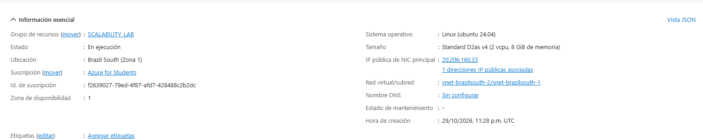
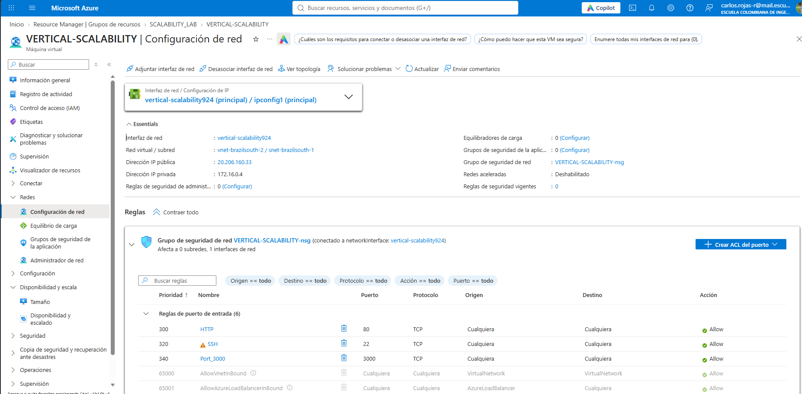
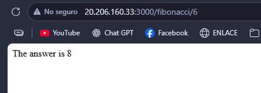
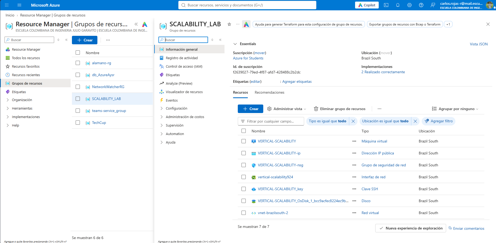
2. ¿Brevemente describa para qué sirve cada recurso?

| Recurso | Tipo | Propósito |
|---|---|---|
| VERTICAL-SCALABILITY | Máquina virtual | Servidor donde corre Ubuntu y la aplicación (cómputo: vCPU y RAM). |
| VERTICAL-SCALABILITY_OsDisk_1_… | Disco | Disco del sistema operativo, donde viven Ubuntu, Node.js y el repositorio. |
| vertical-scalability924 | Interfaz de red (NIC) | Conecta la VM a la red virtual y le da la IP privada (172.16.0.4); a ella se asocian la IP pública y el NSG. |
| VERTICAL-SCALABILITY-ip | Dirección IP pública | Permite alcanzar la VM desde internet (20.206.160.33). |
| VERTICAL-SCALABILITY-nsg | Grupo de seguridad de red | Firewall: decide qué tráfico entra y sale de la VM según puerto, protocolo y origen. |
| vnet-brazilsouth-2 | Red virtual | Red privada que contiene la subred (`snet-brazilsouth-1`) donde está la NIC. |
| VERTICAL-SCALABILITY_key | Clave SSH | Almacena la llave pública para autenticarse por SSH sin contraseña. |


3. ¿Al cerrar la conexión ssh con la VM, por qué se cae la aplicación que ejecutamos con el comando `npm FibonacciApp.js`? ¿Por qué debemos crear un *Inbound port rule* antes de acceder al servicio?

- Al ejecutar `node FibonacciApp.js` directamente, el proceso queda como hijo de la sesión de la terminal. Al cerrarse la sesión SSH el sistema le envía la señal `SIGHUP` y el proceso termina. Con `forever` (también sirven `nohup`, `pm2` o `systemd`) el proceso se separa de la sesión y sigue ejecutándose en segundo plano.
- El NSG trae por defecto la regla `DenyAllInBound`, que descarta todo el tráfico de entrada no permitido explícitamente. Solo estaban abiertos SSH (22) y HTTP (80). Como la aplicación escucha en el puerto **3000**, hasta que no se crea la regla de entrada para ese puerto los paquetes se descartan y el servicio no es alcanzable, aunque la aplicación esté corriendo.

4. Adjunte tabla de tiempos e interprete por qué la función tarda tando tiempo.

Tiempos medidos con `curl` desde un PC local hacia la VM (incluyen la latencia de red hacia Brasil, de unos cientos de milisegundos).

| n | D2as_v4 (2 vCPU) | D4s_v4 (4 vCPU) |
|---|------------------|---|
| 1.000.000 | 7,36 s           | 9,49 s |
| 1.010.000 | 7,31 s           | 9,59 s |
| 1.020.000 | 6,61 s           | 9,89 s |
| 1.030.000 | 7,63 s           | 11,00 s |
| 1.040.000 | 7,67 s           | 10,24 s |
| 1.050.000 | 7,08 s           | 10,63 s |
| 1.060.000 | 7,22 s           | 11,48 s |
| 1.070.000 | 8,17 s           | 10,81 s |
| 1.080.000 | 7,49 s           | 11,92 s |
| 1.090.000 | 7,55 s           | 11,22 s |
| **Promedio** | **7,41 s**       | **10,63 s** |
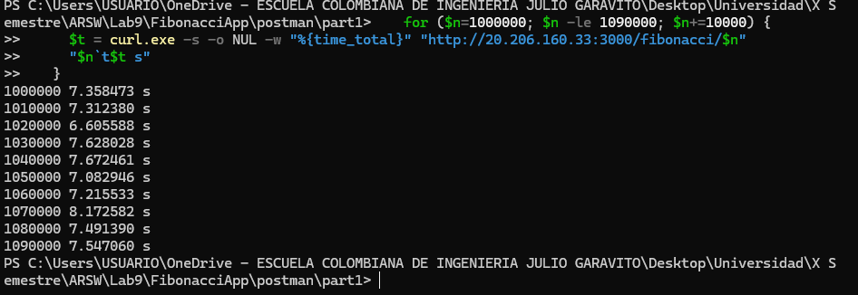
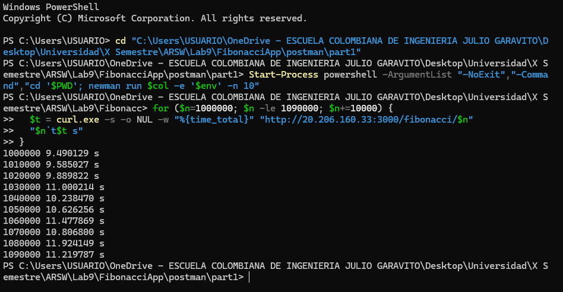
**Por qué tarda tanto.** `FibonacciService.getNthNumberInSequence` es un ciclo iterativo que realiza `n - 1` sumas con la
librería `big-integer` (aritmética de precisión arbitraria). Para n ≈ 1.000.000 el resultado tiene cerca de 209.000 dígitos, 
por lo que cada suma opera sobre números enormes y crea un objeto nuevo; el costo total crece más que linealmente con n. 
Además, el cálculo se ejecuta de forma síncrona dentro del manejador de Express, en el **único hilo** de Node.js, de modo que 
mientras una petición se calcula el servidor no atiende ninguna otra. Las pequeñas variaciones entre filas se deben a ruido de red y a la carga momentánea de la VM.

5. Adjunte imágen del consumo de CPU de la VM e interprete por qué la función consume esa cantidad de CPU.
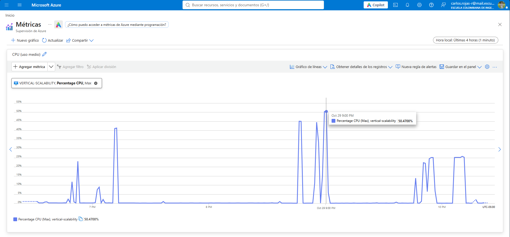

La función es **CPU-bound** (no espera entrada/salida) y es **mono-hilo**, así que mantiene un solo núcleo al 100 % mientras calcula. Eso se ve en la gráfica:

| Fase | Pico de CPU total | Equivalente |
|---|---|---|
| D2as_v4 (2 vCPU) | ~50 % | 1 núcleo de 2 al 100 % |
| D4s_v4 (4 vCPU) | ~25 % (meseta) | 1 núcleo de 4 al 100 % |

El porcentaje total de la VM parece bajo, pero el núcleo que trabaja está saturado y los demás permanecen ociosos.
6. Adjunte la imagen del resumen de la ejecución de Postman. Interprete:
    * Tiempos de ejecución de cada petición.
    * Si hubo fallos documentelos y explique.

Colección `part1`, 10 iteraciones por corrida, petición `GET /fibonacci/1000000`. En todas las corridas hubo **0 fallos** (10/10 iteraciones, requests y test-scripts exitosos).

| Escenario | Duración total | Tiempo promedio por petición | Mín / Máx | Desv. est. |
|---|---|---|---|---|
| D2as_v4, 1 corrida | 1 min 14,8 s | 7,4 s | 7,3 / 7,6 s | 86 ms |
| D2as_v4, 2 corridas (A) | 2 min 4,4 s | 12,3 s | 7,3 / 13,5 s | 1,8 s |
| D2as_v4, 2 corridas (B) | 2 min 14,4 s | 13,3 s | 7,3 / 20,1 s | 2,9 s |
| D4s_v4, 2 corridas (A) | 2 min 51,3 s | 17,0 s | 9,1 / 25,5 s | 3,7 s |
| D4s_v4, 2 corridas (B) | 2 min 42,5 s | 16,1 s | 9,0 / 17,9 s | 2,4 s |

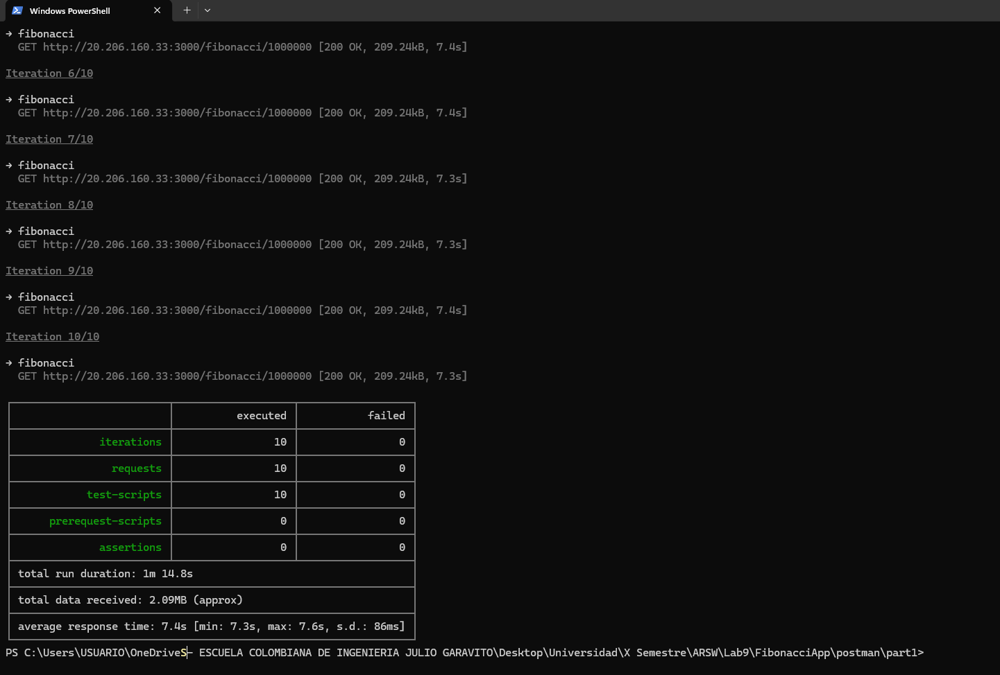
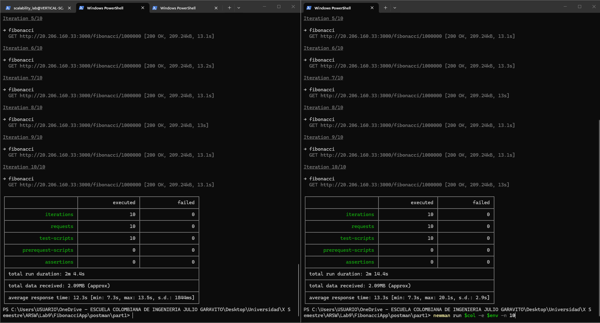
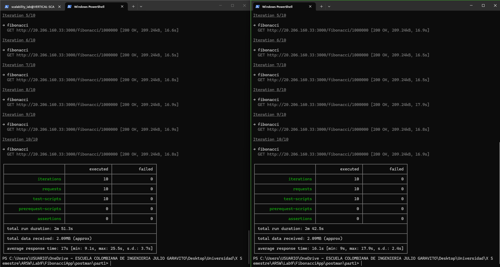

**Análisis.** Con una sola corrida cada petición tarda ~7,4 s, que es el costo del cálculo. Con dos corridas en paralelo el 
promedio sube a ~13 s y el máximo a 20 s, porque Node procesa un cálculo a la vez y las peticiones concurrentes hacen fila. 
No hubo fallos porque Newman no impone un timeout corto y el servidor solo **encola**; un cliente real con timeout sí habría fallado 
en las peticiones de 13 a 25 s. Se documenta entonces **degradación de latencia sin errores**.

7. ¿Cuál es la diferencia entre los tamaños `B2ms` y `B1ls` (no solo busque especificaciones de infraestructura)?

Las dos máquinas que se usaron en el laboratorio fueron `D2as_v4` y `D4s_v4`. Sus diferencias:

| | D2as_v4 (base) | D4s_v4 (escalada) |
|---|---|---|
| vCPU | 2 | 4 |
| RAM | 8 GiB | 16 GiB |
| Procesador | AMD EPYC 7763 | Intel Xeon Platinum 8272CL @ 2,60 GHz |
| IOPS máximos | 3200 | 6400 |
| Discos de datos | 4 | 8 |
| Almacenamiento local | 16 GiB | Ninguno |
| Costo al mes | USD 111,69 | USD 223,38 |

Más allá de las especificaciones de infraestructura, lo que realmente marca la diferencia en este caso es cómo las usa la aplicación:

- **Más núcleos no implica más rapidez para esta aplicación.** FibonacciApp ejecuta el cálculo en un solo hilo de Node.js, así que la D4s_v4 solo aprovecha 1 de sus 4 núcleos, igual que la D2as_v4 aprovecha 1 de sus 2. Los núcleos y la RAM adicionales quedan ociosos.
- **Importa la velocidad de cada núcleo.** El AMD EPYC 7763 de la D2as_v4 rinde más por núcleo que el Intel Xeon Platinum 8272CL de la D4s_v4. Por eso, aunque la segunda es el doble de grande, cada petición fue más lenta (en promedio ~43 % en la tabla de tiempos).
- **Las dos son de uso general** (serie D), con CPU de rendimiento sostenido. No hay límites por créditos de CPU durante una carga continua.
- **La memoria extra tampoco ayudó**: el cálculo no necesita 8 GiB y menos aún 16 GiB.
- **Costo.** La segunda cuesta el doble sin dar una mejora a cambio.
> **Nota:** el enunciado pide comparar `B1ls` y `B2ms`, pero con la suscripción **Azure for Students** no fue posible crear la VM con 
> `B1ls` ni escalar a `B2ms` (el portal no permitía seleccionarlas en esta cuenta). Por eso se trabajó con `D2as_v4` como tamaño base y `D4s_v4` 
> como tamaño escalado; `D4as_v4` tampoco se pudo usar por la cuota de vCPU de la familia.

8. ¿Aumentar el tamaño de la VM es una buena solución en este escenario?, ¿Qué pasa con la FibonacciApp cuando cambiamos el tamaño de la VM?

No es una buena solución para este problema. La aplicación usa un solo hilo, así que los núcleos adicionales no se aprovechan 
y cada petición individual no se acelera. Al redimensionar, la VM se reinicia y la aplicación **deja de estar disponible**: 
el proceso de `forever` no vuelve a arrancar solo, por lo que fue necesario conectarse por SSH y ejecutar de nuevo `forever start FibonacciApp.js`.

9. ¿Qué pasa con la infraestructura cuando cambia el tamaño de la VM? ¿Qué efectos negativos implica?

- La VM se detiene y reinicia (posiblemente en otro servidor físico), con **tiempo de inactividad**.
- La IP pública puede cambiar si es dinámica, y hay que revisar la configuración de los clientes.
- Los datos del disco temporal pueden perderse.
- El **costo se duplica**: D2as_v4 cuesta ~USD 111,69/mes y D4s_v4 ~USD 223,38/mes.
- Existen límites: `D4as_v4` no pudo usarse por la cuota de la suscripción (2 de 4 vCPU disponibles) y algunos tamaños no están soportados en la zona de disponibilidad 1.
- Sigue habiendo un **único punto de falla**: una sola VM, una sola zona.
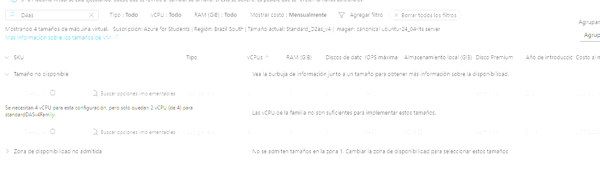
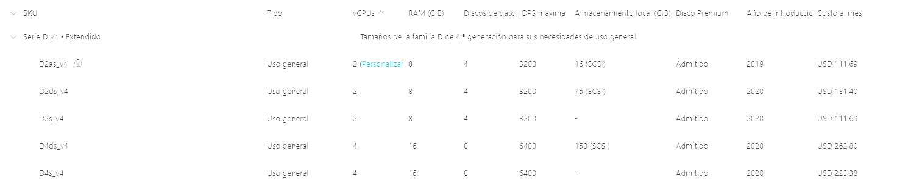
10. ¿Hubo mejora en el consumo de CPU o en los tiempos de respuesta? Si/No ¿Por qué?

**No.** Con la D4s_v4 los tiempos empeoraron:

| Medición | D2as_v4 | D4s_v4 |
|---|---|---|
| Tabla de tiempos (promedio) | 7,41 s | 10,63 s (+43 %) |
| Newman, 2 corridas (promedio) | 12,3 s y 13,3 s | 17,0 s y 16,1 s (+~29 %) |

La aplicación solo usa un núcleo, así que importa la velocidad de cada núcleo y no cuántos haya. El AMD EPYC 7763 de la D2as_v4 
rinde más por núcleo que el Intel Xeon Platinum 8272CL de la D4s_v4, de modo que la VM "más grande" resultó más lenta. 
Es la explicación más probable, apoyada en que la CPU total solo muestra un núcleo saturado.

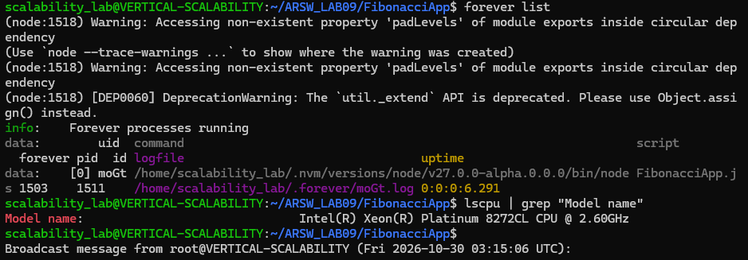

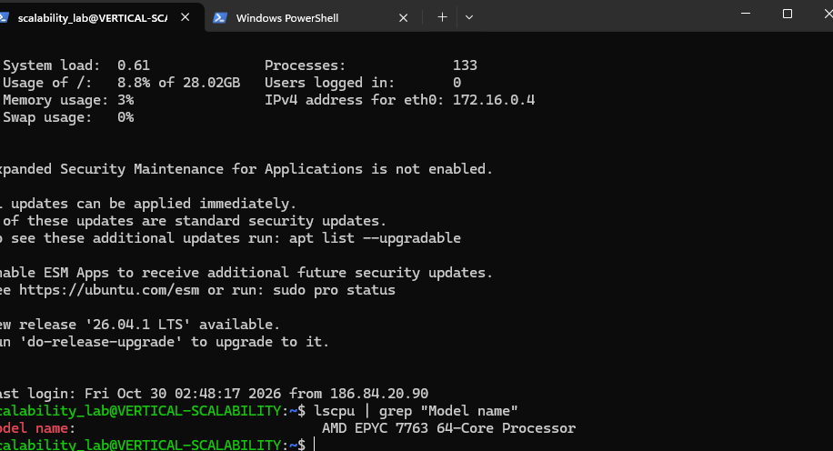
11. Aumente la cantidad de ejecuciones paralelas del comando de postman a `4`. ¿El comportamiento del sistema es porcentualmente mejor?

**No.** Se ejecutaron 4 corridas simultáneas en la D4s_v4, todas sin fallos:

| Ventana | Duración total | Promedio | Mín / Máx |
|---|---|---|---|
| 1 | 5 min 37 s | 33,6 s | 17,0 / 53,2 s |
| 2 | 5 min 44 s | 34,3 s | 17,6 / 52,3 s |
| 3 | 4 min 57 s | 29,6 s | 17,3 / 57,1 s |
| 4 | 5 min 8 s | 30,7 s | 24,8 / 51,1 s |

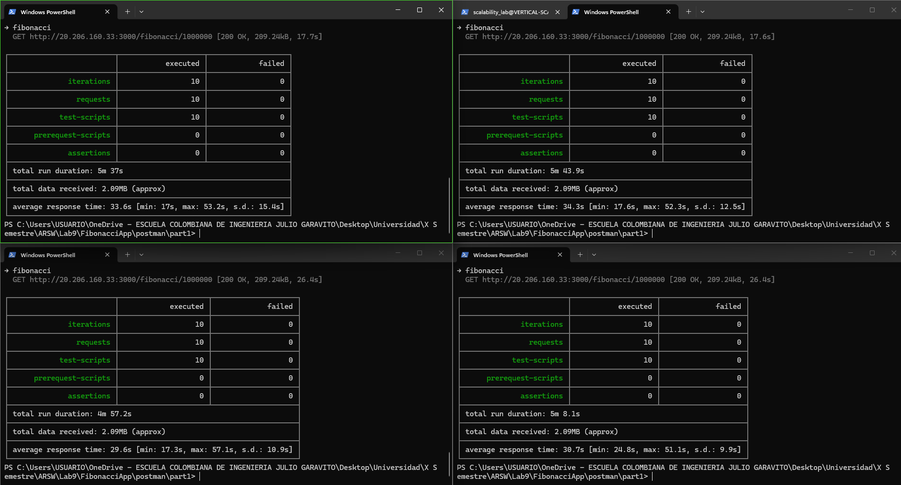

El tiempo por petición crece casi en línea recta con el número de clientes (≈16,6 s con 2 corridas, ≈32 s con 4). 
El **rendimiento (throughput) no cambia**: el servidor procesó 40 peticiones en ~5 min 44 s (una cada ~8,6 s), y 20 peticiones 
en ~2 min 51 s con dos corridas (también una cada ~8,6 s). Agregar clientes solo alarga la espera de cada uno, porque un único hilo atiende todo.

## Evaluación del escenario de calidad

El escenario exige que todas las peticiones se respondan con la CPU en 70 % o menos. Medida sobre el total de la VM, 
la CPU nunca superó ~51 %, y todas las peticiones fueron respondidas sin errores. Sin embargo, la métrica engaña: 
el núcleo que ejecuta Node estaba al 100 % y los tiempos de respuesta se degradaron hasta 17 s con 2 usuarios y 32 s con 4. 
**El modelo de escalamiento vertical no cumple satisfactoriamente el escenario**, porque no sostiene tiempos de respuesta aceptables bajo concurrencia y no elimina el único punto de falla.

## Limpieza

La VM se devolvió al tamaño original **D2as_v4**.

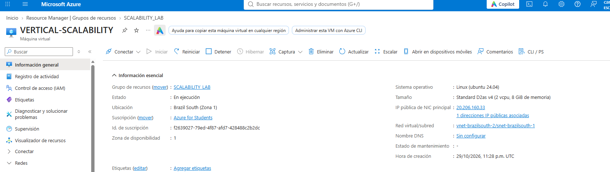

### Parte 2 - Escalabilidad horizontal

#### Crear el Balanceador de Carga

Antes de continuar puede eliminar el grupo de recursos anterior para evitar gastos adicionales y realizar la actividad en un grupo de recursos totalmente limpio.

1. El Balanceador de Carga es un recurso fundamental para habilitar la escalabilidad horizontal de nuestro sistema, por eso en este paso cree un balanceador de carga dentro de Azure tal cual como se muestra en la imágen adjunta.


2. A continuación cree un *Backend Pool*, guiese con la siguiente imágen.


3. A continuación cree un *Health Probe*, guiese con la siguiente imágen.


4. A continuación cree un *Load Balancing Rule*, guiese con la siguiente imágen.


5. Cree una *Virtual Network* dentro del grupo de recursos, guiese con la siguiente imágen.


#### Crear las maquinas virtuales (Nodos)

Ahora vamos a crear 3 VMs (VM1, VM2 y VM3) con direcciones IP públicas standar en 3 diferentes zonas de disponibilidad. Después las agregaremos al balanceador de carga.

1. En la configuración básica de la VM guíese por la siguiente imágen. Es importante que se fije en la "Avaiability Zone", donde la VM1 será 1, la VM2 será 2 y la VM3 será 3.


2. En la configuración de networking, verifique que se ha seleccionado la *Virtual Network*  y la *Subnet* creadas anteriormente. Adicionalmente asigne una IP pública y no olvide habilitar la redundancia de zona.


3. Para el Network Security Group seleccione "avanzado" y realice la siguiente configuración. No olvide crear un *Inbound Rule*, en el cual habilite el tráfico por el puerto 3000. Cuando cree la VM2 y la VM3, no necesita volver a crear el *Network Security Group*, sino que puede seleccionar el anteriormente creado.


4. Ahora asignaremos esta VM a nuestro balanceador de carga, para ello siga la configuración de la siguiente imágen.


5. Finalmente debemos instalar la aplicación de Fibonacci en la VM. para ello puede ejecutar el conjunto de los siguientes comandos, cambiando el nombre de la VM por el correcto

```
git clone https://github.com/daprieto1/ARSW_LOAD-BALANCING_AZURE.git

curl -o- https://raw.githubusercontent.com/creationix/nvm/v0.34.0/install.sh | bash
source /home/vm1/.bashrc
nvm install node

cd ARSW_LOAD-BALANCING_AZURE/FibonacciApp
npm install

npm install forever -g
forever start FibonacciApp.js
```

Realice este proceso para las 3 VMs, por ahora lo haremos a mano una por una, sin embargo es importante que usted sepa que existen herramientas para aumatizar este proceso, entre ellas encontramos Azure Resource Manager, OsDisk Images, Terraform con Vagrant y Paker, Puppet, Ansible entre otras.

#### Probar el resultado final de nuestra infraestructura

1. Porsupuesto el endpoint de acceso a nuestro sistema será la IP pública del balanceador de carga, primero verifiquemos que los servicios básicos están funcionando, consuma los siguientes recursos:

```
http://52.155.223.248/
http://52.155.223.248/fibonacci/1
```

2. Realice las pruebas de carga con `newman` que se realizaron en la parte 1 y haga un informe comparativo donde contraste: tiempos de respuesta, cantidad de peticiones respondidas con éxito, costos de las 2 infraestrucruras, es decir, la que desarrollamos con balanceo de carga horizontal y la que se hizo con una maquina virtual escalada.

3. Agregue una 4 maquina virtual y realice las pruebas de newman, pero esta vez no lance 2 peticiones en paralelo, sino que incrementelo a 4. Haga un informe donde presente el comportamiento de la CPU de las 4 VM y explique porque la tasa de éxito de las peticiones aumento con este estilo de escalabilidad.

```
newman run ARSW_LOAD-BALANCING_AZURE.postman_collection.json -e [ARSW_LOAD-BALANCING_AZURE].postman_environment.json -n 10 &
newman run ARSW_LOAD-BALANCING_AZURE.postman_collection.json -e [ARSW_LOAD-BALANCING_AZURE].postman_environment.json -n 10 &
newman run ARSW_LOAD-BALANCING_AZURE.postman_collection.json -e [ARSW_LOAD-BALANCING_AZURE].postman_environment.json -n 10 &
newman run ARSW_LOAD-BALANCING_AZURE.postman_collection.json -e [ARSW_LOAD-BALANCING_AZURE].postman_environment.json -n 10
```

**Preguntas**

* ¿Cuáles son los tipos de balanceadores de carga en Azure y en qué se diferencian?, ¿Qué es SKU, qué tipos hay y en qué se diferencian?, ¿Por qué el balanceador de carga necesita una IP pública?
* ¿Cuál es el propósito del *Backend Pool*?
* ¿Cuál es el propósito del *Health Probe*?
* ¿Cuál es el propósito de la *Load Balancing Rule*? ¿Qué tipos de sesión persistente existen, por qué esto es importante y cómo puede afectar la escalabilidad del sistema?.
* ¿Qué es una *Virtual Network*? ¿Qué es una *Subnet*? ¿Para qué sirven los *address space* y *address range*?
* ¿Qué son las *Availability Zone* y por qué seleccionamos 3 diferentes zonas?. ¿Qué significa que una IP sea *zone-redundant*?
* ¿Cuál es el propósito del *Network Security Group*?
* Informe de newman 1 (Punto 2)
* Presente el Diagrama de Despliegue de la solución.


