### Escuela Colombiana de Ingeniería
### Arquitecturas de Software - ARSW

**Autores:** Juan Daniel Bogotá, <NOMBRE DE KALICHE>

## Escalamiento en Azure con Maquinas Virtuales, Sacale Sets y Service Plans

### Dependencias
* Cree una cuenta gratuita dentro de Azure. Para hacerlo puede guiarse de esta [documentación](https://azure.microsoft.com/es-es/free/students/). Al hacerlo usted contará con $100 USD para gastar durante 12 meses.

### Parte 0 - Entendiendo el escenario de calidad

Adjunto a este laboratorio usted podrá encontrar una aplicación totalmente desarrollada que tiene como objetivo calcular el enésimo valor de la secuencia de Fibonnaci.

**Escalabilidad**
Cuando un conjunto de usuarios consulta un enésimo número (superior a 1000000) de la secuencia de Fibonacci de forma concurrente y el sistema se encuentra bajo condiciones normales de operación, todas las peticiones deben ser respondidas y el consumo de CPU del sistema no puede superar el 70%.

### Parte 1 - Escalabilidad vertical

1. Diríjase a el [Portal de Azure](https://portal.azure.com/) y a continuación cree una maquina virtual con las características básicas descritas en la imágen 1 y que corresponden a las siguientes:
    * Resource Group = SCALABILITY_LAB
    * Virtual machine name = VERTICAL-SCALABILITY
    * Image = Ubuntu Server 
    * Size = Standard B1ls
    * Username = scalability_lab
    * SSH publi key = Su llave ssh publica


2. Para conectarse a la VM use el siguiente comando, donde las `x` las debe remplazar por la IP de su propia VM (Revise la sección "Connect" de la virtual machine creada para tener una guía más detallada).

    `ssh scalability_lab@xxx.xxx.xxx.xxx`

3. Instale node, para ello siga la sección *Installing Node.js and npm using NVM* que encontrará en este [enlace](https://linuxize.com/post/how-to-install-node-js-on-ubuntu-18.04/).
4. Para instalar la aplicación adjunta al Laboratorio, suba la carpeta `FibonacciApp` a un repositorio al cual tenga acceso y ejecute estos comandos dentro de la VM:

    `git clone <your_repo>`

    `cd <your_repo>/FibonacciApp`

    `npm install`

5. Para ejecutar la aplicación puede usar el comando `npm FibinacciApp.js`, sin embargo una vez pierda la conexión ssh la aplicación dejará de funcionar. Para evitar ese compartamiento usaremos *forever*. Ejecute los siguientes comando dentro de la VM.

    ` node FibonacciApp.js`

6. Antes de verificar si el endpoint funciona, en Azure vaya a la sección de *Networking* y cree una *Inbound port rule* tal como se muestra en la imágen. Para verificar que la aplicación funciona, use un browser y user el endpoint `http://xxx.xxx.xxx.xxx:3000/fibonacci/6`. La respuesta debe ser `The answer is 8`.


7. La función que calcula en enésimo número de la secuencia de Fibonacci está muy mal construido y consume bastante CPU para obtener la respuesta. Usando la consola del Browser documente los tiempos de respuesta para dicho endpoint usando los siguintes valores:
    * 1000000
    * 1010000
    * 1020000
    * 1030000
    * 1040000
    * 1050000
    * 1060000
    * 1070000
    * 1080000
    * 1090000    

8. Dírijase ahora a Azure y verifique el consumo de CPU para la VM. (Los resultados pueden tardar 5 minutos en aparecer).


9. Ahora usaremos Postman para simular una carga concurrente a nuestro sistema. Siga estos pasos.
    * Instale newman con el comando `npm install newman -g`. Para conocer más de Newman consulte el siguiente [enlace](https://learning.getpostman.com/docs/postman/collection-runs/command-line-integration-with-newman/).
    * Diríjase hasta la ruta `FibonacciApp/postman` en una maquina diferente a la VM.
    * Para el archivo `[ARSW_LOAD-BALANCING_AZURE].postman_environment.json` cambie el valor del parámetro `VM1` para que coincida con la IP de su VM.
    * Ejecute el siguiente comando.

    ```
    newman run ARSW_LOAD-BALANCING_AZURE.postman_collection.json -e [ARSW_LOAD-BALANCING_AZURE].postman_environment.json -n 10 &
    newman run ARSW_LOAD-BALANCING_AZURE.postman_collection.json -e [ARSW_LOAD-BALANCING_AZURE].postman_environment.json -n 10
    ```

10. La cantidad de CPU consumida es bastante grande y un conjunto considerable de peticiones concurrentes pueden hacer fallar nuestro servicio. Para solucionarlo usaremos una estrategia de Escalamiento Vertical. En Azure diríjase a la sección *size* y a continuación seleccione el tamaño `B2ms`.


11. Una vez el cambio se vea reflejado, repita el paso 7, 8 y 9.
12. Evalue el escenario de calidad asociado al requerimiento no funcional de escalabilidad y concluya si usando este modelo de escalabilidad logramos cumplirlo.
13. Vuelva a dejar la VM en el tamaño inicial para evitar cobros adicionales.

**Preguntas**

1. ¿Cuántos y cuáles recursos crea Azure junto con la VM?

Antes de todo. La suscripción **Azure for Students** no permitió crear la VM con el tamaño `Standard B1ls` que pide la guía. La VM se creó con **Standard D2as_v4** 
(2 vCPU, 8 GiB, AMD EPYC 7763) en Brazil South, zona 1. Como ese tamaño ya equivale en vCPU y RAM a un B2ms, el escalamiento vertical se hizo hacia **Standard D4s_v4** 
(4 vCPU, 16 GiB, Intel Xeon Platinum 8272CL). `D4as_v4` fue bloqueado por cuota de la suscripción (solo quedaban 2 de 4 vCPU de la familia DASv4). Al terminar, la VM se devolvió a D2as_v4.

Azure creó **7 recursos**: la máquina virtual, el disco del sistema operativo, la interfaz de red, la dirección IP pública, el grupo de seguridad de red (NSG), la red virtual y la clave SSH.


2. ¿Brevemente describa para qué sirve cada recurso?

| Recurso | Tipo | Propósito |
|---|---|---|
| VERTICAL-SCALABILITY | Máquina virtual | Servidor donde corre Ubuntu y la aplicación (cómputo: vCPU y RAM). |
| VERTICAL-SCALABILITY_OsDisk_1_… | Disco | Disco del sistema operativo, donde viven Ubuntu, Node.js y el repositorio. |
| vertical-scalability924 | Interfaz de red (NIC) | Conecta la VM a la red virtual y le da la IP privada (172.16.0.4); a ella se asocian la IP pública y el NSG. |
| VERTICAL-SCALABILITY-ip | Dirección IP pública | Permite alcanzar la VM desde internet (20.206.160.33). |
| VERTICAL-SCALABILITY-nsg | Grupo de seguridad de red | Firewall: decide qué tráfico entra y sale de la VM según puerto, protocolo y origen. |
| vnet-brazilsouth-2 | Red virtual | Red privada que contiene la subred (`snet-brazilsouth-1`) donde está la NIC. |
| VERTICAL-SCALABILITY_key | Clave SSH | Almacena la llave pública para autenticarse por SSH sin contraseña. |


3. ¿Al cerrar la conexión ssh con la VM, por qué se cae la aplicación que ejecutamos con el comando `npm FibonacciApp.js`? ¿Por qué debemos crear un *Inbound port rule* antes de acceder al servicio?

- Al ejecutar `node FibonacciApp.js` directamente, el proceso queda como hijo de la sesión de la terminal. Al cerrarse la sesión SSH el sistema le envía la señal `SIGHUP` y el proceso termina. Con `forever` (también sirven `nohup`, `pm2` o `systemd`) el proceso se separa de la sesión y sigue ejecutándose en segundo plano.
- El NSG trae por defecto la regla `DenyAllInBound`, que descarta todo el tráfico de entrada no permitido explícitamente. Solo estaban abiertos SSH (22) y HTTP (80). Como la aplicación escucha en el puerto **3000**, hasta que no se crea la regla de entrada para ese puerto los paquetes se descartan y el servicio no es alcanzable, aunque la aplicación esté corriendo.

4. Adjunte tabla de tiempos e interprete por qué la función tarda tando tiempo.

Tiempos medidos con `curl` desde un PC local hacia la VM (incluyen la latencia de red hacia Brasil, de unos cientos de milisegundos).

| n | D2as_v4 (2 vCPU) | D4s_v4 (4 vCPU) |
|---|------------------|---|
| 1.000.000 | 7,36 s           | 9,49 s |
| 1.010.000 | 7,31 s           | 9,59 s |
| 1.020.000 | 6,61 s           | 9,89 s |
| 1.030.000 | 7,63 s           | 11,00 s |
| 1.040.000 | 7,67 s           | 10,24 s |
| 1.050.000 | 7,08 s           | 10,63 s |
| 1.060.000 | 7,22 s           | 11,48 s |
| 1.070.000 | 8,17 s           | 10,81 s |
| 1.080.000 | 7,49 s           | 11,92 s |
| 1.090.000 | 7,55 s           | 11,22 s |
| **Promedio** | **7,41 s**       | **10,63 s** |


**Por qué tarda tanto.** `FibonacciService.getNthNumberInSequence` es un ciclo iterativo que realiza `n - 1` sumas con la
librería `big-integer` (aritmética de precisión arbitraria). Para n ≈ 1.000.000 el resultado tiene cerca de 209.000 dígitos, 
por lo que cada suma opera sobre números enormes y crea un objeto nuevo; el costo total crece más que linealmente con n. 
Además, el cálculo se ejecuta de forma síncrona dentro del manejador de Express, en el **único hilo** de Node.js, de modo que 
mientras una petición se calcula el servidor no atiende ninguna otra. Las pequeñas variaciones entre filas se deben a ruido de red y a la carga momentánea de la VM.

5. Adjunte imágen del consumo de CPU de la VM e interprete por qué la función consume esa cantidad de CPU.


La función es **CPU-bound** (no espera entrada/salida) y es **mono-hilo**, así que mantiene un solo núcleo al 100 % mientras calcula. Eso se ve en la gráfica:

| Fase | Pico de CPU total | Equivalente |
|---|---|---|
| D2as_v4 (2 vCPU) | ~50 % | 1 núcleo de 2 al 100 % |
| D4s_v4 (4 vCPU) | ~25 % (meseta) | 1 núcleo de 4 al 100 % |

El porcentaje total de la VM parece bajo, pero el núcleo que trabaja está saturado y los demás permanecen ociosos.
6. Adjunte la imagen del resumen de la ejecución de Postman. Interprete:
    * Tiempos de ejecución de cada petición.
    * Si hubo fallos documentelos y explique.

Colección `part1`, 10 iteraciones por corrida, petición `GET /fibonacci/1000000`. En todas las corridas hubo **0 fallos** (10/10 iteraciones, requests y test-scripts exitosos).

| Escenario | Duración total | Tiempo promedio por petición | Mín / Máx | Desv. est. |
|---|---|---|---|---|
| D2as_v4, 1 corrida | 1 min 14,8 s | 7,4 s | 7,3 / 7,6 s | 86 ms |
| D2as_v4, 2 corridas (A) | 2 min 4,4 s | 12,3 s | 7,3 / 13,5 s | 1,8 s |
| D2as_v4, 2 corridas (B) | 2 min 14,4 s | 13,3 s | 7,3 / 20,1 s | 2,9 s |
| D4s_v4, 2 corridas (A) | 2 min 51,3 s | 17,0 s | 9,1 / 25,5 s | 3,7 s |
| D4s_v4, 2 corridas (B) | 2 min 42,5 s | 16,1 s | 9,0 / 17,9 s | 2,4 s |


**Análisis.** Con una sola corrida cada petición tarda ~7,4 s, que es el costo del cálculo. Con dos corridas en paralelo el 
promedio sube a ~13 s y el máximo a 20 s, porque Node procesa un cálculo a la vez y las peticiones concurrentes hacen fila. 
No hubo fallos porque Newman no impone un timeout corto y el servidor solo **encola**; un cliente real con timeout sí habría fallado 
en las peticiones de 13 a 25 s. Se documenta entonces **degradación de latencia sin errores**.

7. ¿Cuál es la diferencia entre los tamaños `B2ms` y `B1ls` (no solo busque especificaciones de infraestructura)?

Las dos máquinas que se usaron en el laboratorio fueron `D2as_v4` y `D4s_v4`. Sus diferencias:

| | D2as_v4 (base) | D4s_v4 (escalada) |
|---|---|---|
| vCPU | 2 | 4 |
| RAM | 8 GiB | 16 GiB |
| Procesador | AMD EPYC 7763 | Intel Xeon Platinum 8272CL @ 2,60 GHz |
| IOPS máximos | 3200 | 6400 |
| Discos de datos | 4 | 8 |
| Almacenamiento local | 16 GiB | Ninguno |
| Costo al mes | USD 111,69 | USD 223,38 |

Más allá de las especificaciones de infraestructura, lo que realmente marca la diferencia en este caso es cómo las usa la aplicación:

- **Más núcleos no implica más rapidez para esta aplicación.** FibonacciApp ejecuta el cálculo en un solo hilo de Node.js, así que la D4s_v4 solo aprovecha 1 de sus 4 núcleos, igual que la D2as_v4 aprovecha 1 de sus 2. Los núcleos y la RAM adicionales quedan ociosos.
- **Importa la velocidad de cada núcleo.** El AMD EPYC 7763 de la D2as_v4 rinde más por núcleo que el Intel Xeon Platinum 8272CL de la D4s_v4. Por eso, aunque la segunda es el doble de grande, cada petición fue más lenta (en promedio ~43 % en la tabla de tiempos).
- **Las dos son de uso general** (serie D), con CPU de rendimiento sostenido. No hay límites por créditos de CPU durante una carga continua.
- **La memoria extra tampoco ayudó**: el cálculo no necesita 8 GiB y menos aún 16 GiB.
- **Costo.** La segunda cuesta el doble sin dar una mejora a cambio.
> **Nota:** el enunciado pide comparar `B1ls` y `B2ms`, pero con la suscripción **Azure for Students** no fue posible crear la VM con 
> `B1ls` ni escalar a `B2ms` (el portal no permitía seleccionarlas en esta cuenta). Por eso se trabajó con `D2as_v4` como tamaño base y `D4s_v4` 
> como tamaño escalado; `D4as_v4` tampoco se pudo usar por la cuota de vCPU de la familia.

8. ¿Aumentar el tamaño de la VM es una buena solución en este escenario?, ¿Qué pasa con la FibonacciApp cuando cambiamos el tamaño de la VM?

No es una buena solución para este problema. La aplicación usa un solo hilo, así que los núcleos adicionales no se aprovechan 
y cada petición individual no se acelera. Al redimensionar, la VM se reinicia y la aplicación **deja de estar disponible**: 
el proceso de `forever` no vuelve a arrancar solo, por lo que fue necesario conectarse por SSH y ejecutar de nuevo `forever start FibonacciApp.js`.

9. ¿Qué pasa con la infraestructura cuando cambia el tamaño de la VM? ¿Qué efectos negativos implica?

- La VM se detiene y reinicia (posiblemente en otro servidor físico), con **tiempo de inactividad**.
- La IP pública puede cambiar si es dinámica, y hay que revisar la configuración de los clientes.
- Los datos del disco temporal pueden perderse.
- El **costo se duplica**: D2as_v4 cuesta ~USD 111,69/mes y D4s_v4 ~USD 223,38/mes.
- Existen límites: `D4as_v4` no pudo usarse por la cuota de la suscripción (2 de 4 vCPU disponibles) y algunos tamaños no están soportados en la zona de disponibilidad 1.
- Sigue habiendo un **único punto de falla**: una sola VM, una sola zona.


10. ¿Hubo mejora en el consumo de CPU o en los tiempos de respuesta? Si/No ¿Por qué?

**No.** Con la D4s_v4 los tiempos empeoraron:

| Medición | D2as_v4 | D4s_v4 |
|---|---|---|
| Tabla de tiempos (promedio) | 7,41 s | 10,63 s (+43 %) |
| Newman, 2 corridas (promedio) | 12,3 s y 13,3 s | 17,0 s y 16,1 s (+~29 %) |

La aplicación solo usa un núcleo, así que importa la velocidad de cada núcleo y no cuántos haya. El AMD EPYC 7763 de la D2as_v4 
rinde más por núcleo que el Intel Xeon Platinum 8272CL de la D4s_v4, de modo que la VM "más grande" resultó más lenta. 
Es la explicación más probable, apoyada en que la CPU total solo muestra un núcleo saturado.


11. Aumente la cantidad de ejecuciones paralelas del comando de postman a `4`. ¿El comportamiento del sistema es porcentualmente mejor?

**No.** Se ejecutaron 4 corridas simultáneas en la D4s_v4, todas sin fallos:

| Ventana | Duración total | Promedio | Mín / Máx |
|---|---|---|---|
| 1 | 5 min 37 s | 33,6 s | 17,0 / 53,2 s |
| 2 | 5 min 44 s | 34,3 s | 17,6 / 52,3 s |
| 3 | 4 min 57 s | 29,6 s | 17,3 / 57,1 s |
| 4 | 5 min 8 s | 30,7 s | 24,8 / 51,1 s |


El tiempo por petición crece casi en línea recta con el número de clientes (≈16,6 s con 2 corridas, ≈32 s con 4). 
El **rendimiento (throughput) no cambia**: el servidor procesó 40 peticiones en ~5 min 44 s (una cada ~8,6 s), y 20 peticiones 
en ~2 min 51 s con dos corridas (también una cada ~8,6 s). Agregar clientes solo alarga la espera de cada uno, porque un único hilo atiende todo.

## Evaluación del escenario de calidad

El escenario exige que todas las peticiones se respondan con la CPU en 70 % o menos. Medida sobre el total de la VM, 
la CPU nunca superó ~51 %, y todas las peticiones fueron respondidas sin errores. Sin embargo, la métrica engaña: 
el núcleo que ejecuta Node estaba al 100 % y los tiempos de respuesta se degradaron hasta 17 s con 2 usuarios y 32 s con 4. 
**El modelo de escalamiento vertical no cumple satisfactoriamente el escenario**, porque no sostiene tiempos de respuesta aceptables bajo concurrencia y no elimina el único punto de falla.

## Limpieza

La VM se devolvió al tamaño original **D2as_v4**.


### Parte 2 - Escalabilidad horizontal

#### Crear el Balanceador de Carga

Antes de continuar puede eliminar el grupo de recursos anterior para evitar gastos adicionales y realizar la actividad en un grupo de recursos totalmente limpio.

1. El Balanceador de Carga es un recurso fundamental para habilitar la escalabilidad horizontal de nuestro sistema, por eso en este paso cree un balanceador de carga dentro de Azure tal cual como se muestra en la imágen adjunta.


2. A continuación cree un *Backend Pool*, guiese con la siguiente imágen.


3. A continuación cree un *Health Probe*, guiese con la siguiente imágen.


4. A continuación cree un *Load Balancing Rule*, guiese con la siguiente imágen.


5. Cree una *Virtual Network* dentro del grupo de recursos, guiese con la siguiente imágen.


#### Solución del Balanceador de Carga

Esta parte se hizo desde el portal de Azure, siguiendo las imágenes del enunciado. El portal de hoy no es igual al de 2019, así que donde hubo diferencias las dejamos anotadas.

Región. Se usó Chile Central en lugar de North Europe. North Europe está bloqueada por una política de la suscripción de estudiante y las regiones permitidas son centralus, brazilsouth, mexicocentral, eastus2 y chilecentral. En todas el límite es de 6 vCPU por región. En East US 2 la cuota de la familia Dsv7 era 0 y los tamaños de 1 vCPU no estaban disponibles. En Brasil Sur y en México pasaba lo mismo con los de 1 vCPU. Se pidió subir la cuota total de vCPU y la solicitud fue rechazada. En Chile Central sí hay una máquina de 1 vCPU disponible en las 3 zonas, y con ella caben las 4 máquinas que pide el laboratorio.

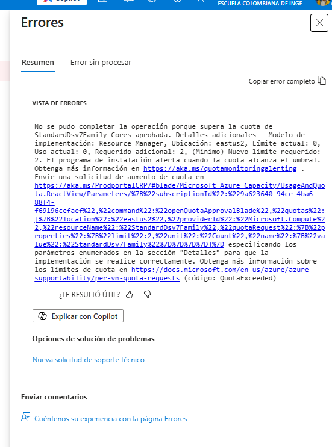

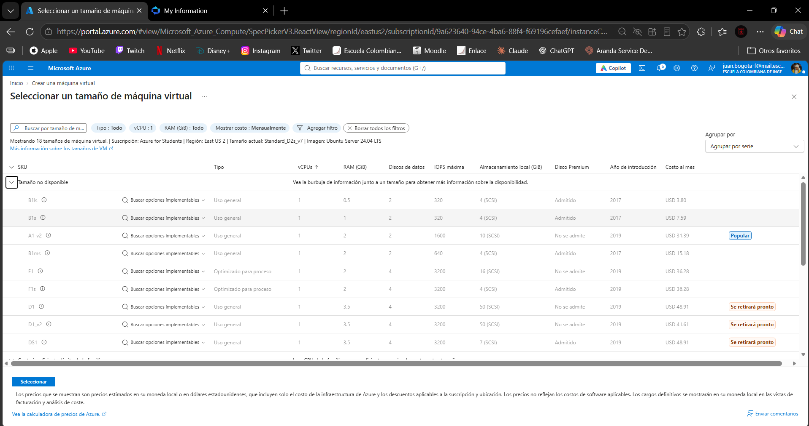

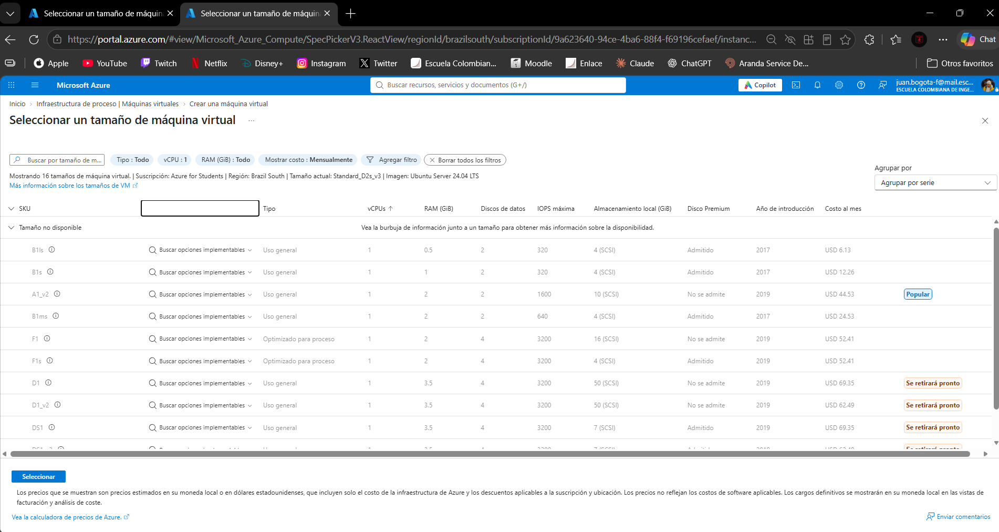

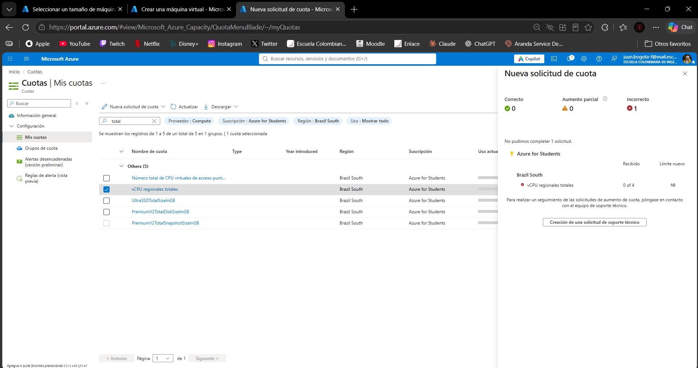

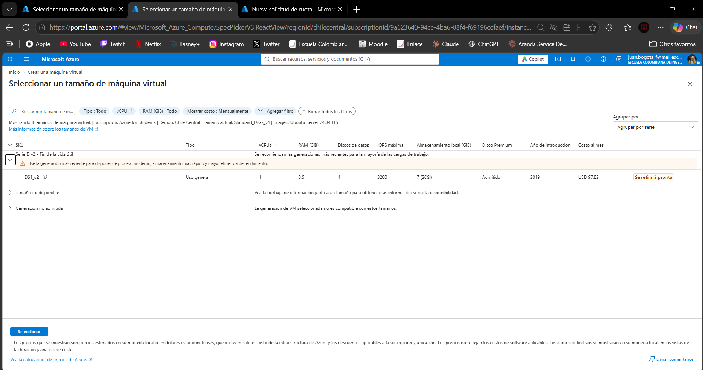

Punto 1, balanceador de carga. Se creó SCALABILITY_LAB_LOAD_BALANCER, público, SKU Estándar y nivel Regional. En el portal actual la IP pública no se crea aparte, se crea dentro del paso Configuración de IP de frontend. Allí se dejó una configuración llamada LoadBalancerFrontEnd con una IP nueva, SCALABILITY_LAB_LOAD_BALANCER_IP, estática y con redundancia de zona. La IP pública quedó en 57.156.38.94.

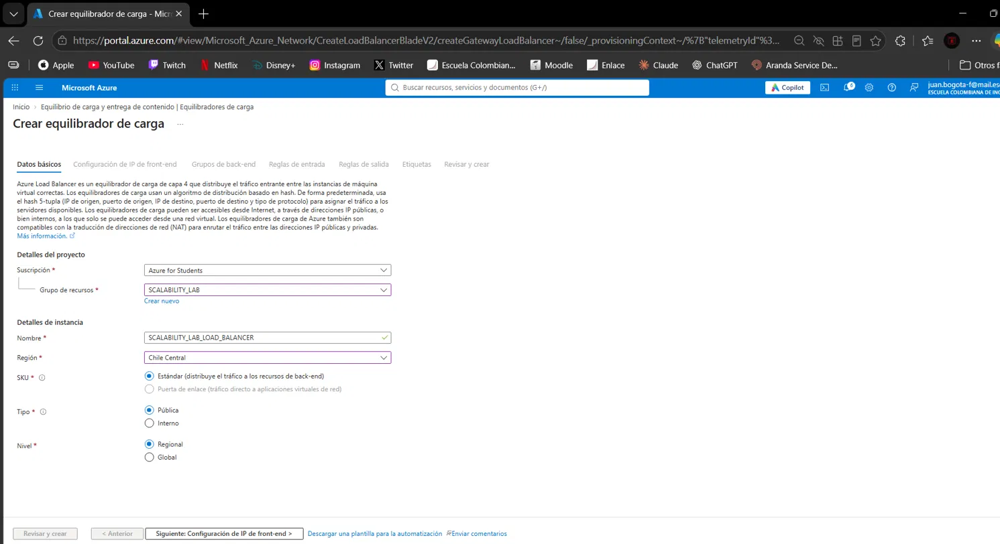

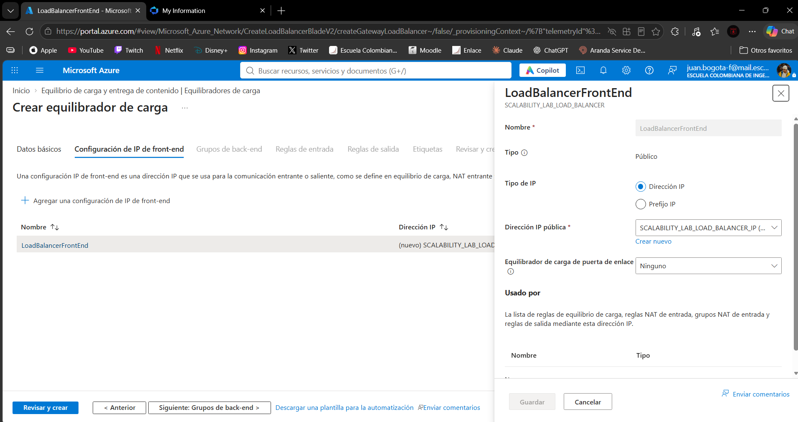

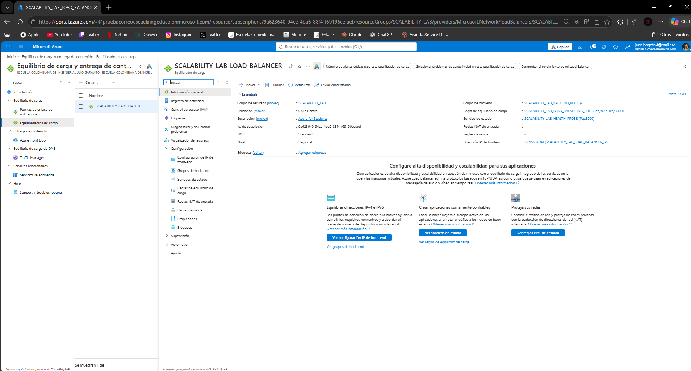

Punto 2, Backend Pool. Se creó SCALABILITY_LAB_BACKEND_POOL y se asoció a la red virtual SCALABILITY_LAB_VIRTUAL_NETWORK. Al principio está vacío y las máquinas se agregan cuando se crean, en el siguiente paso.

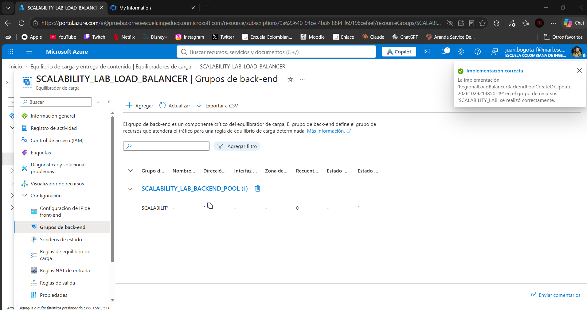

Punto 3, Health Probe. Se creó SCALABILITY_LAB_HEALTH_PROBE con protocolo TCP, puerto 3000 e intervalo de 5 segundos. Esto hace que el balanceador pregunte cada 5 segundos si el puerto 3000 de cada máquina responde, y deje de mandarle tráfico a la que no conteste.

En cuanto a la diferencia con el enunciado, la imagen del enunciado muestra un campo Unhealthy threshold con valor 2, pero el portal actual ya no lo pide. Para saber con qué valor quedó se consultó el sondeo con la línea de comandos de Azure y el umbral es 1, es decir que una máquina se marca como caída con un solo fallo del sondeo.

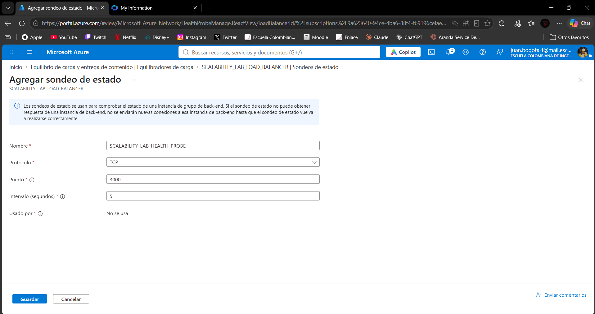

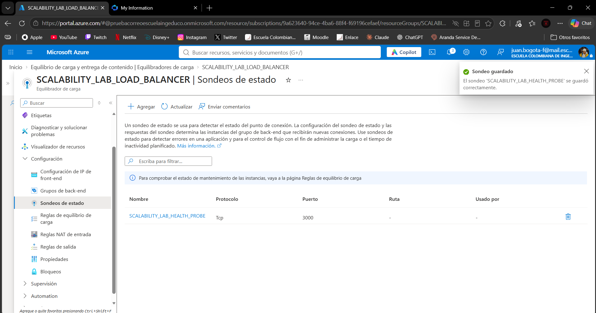

Punto 4, Load Balancing Rule. Se creó SCALABILITY_LAB_LOAD_BALANCING_RULE. Las peticiones que llegan al puerto 80 de la IP del balanceador se reparten entre las máquinas del pool por el puerto 3000, usando el Health Probe anterior. La persistencia de sesión quedó en ninguna, así que cada petición puede ir a una máquina distinta. El resto de opciones se dejó por defecto.

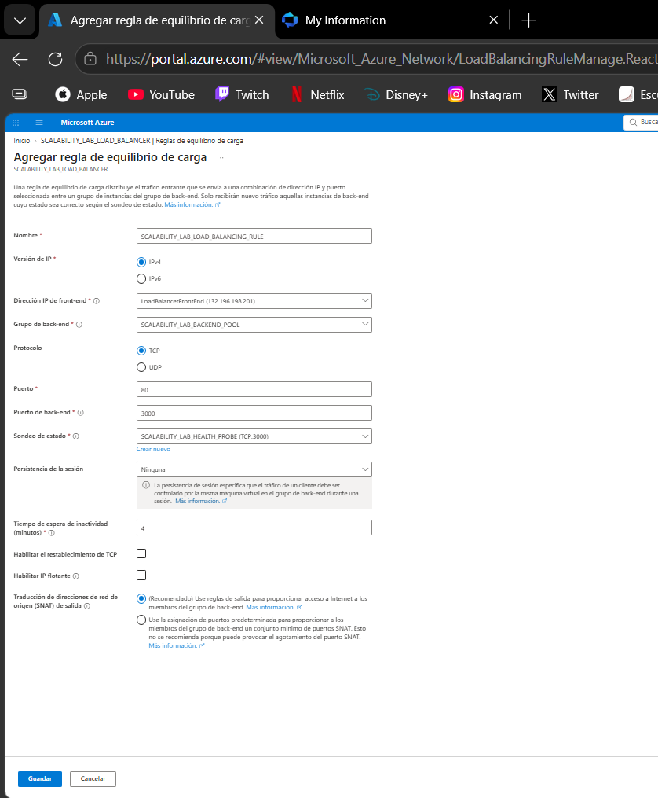

Punto 5, Virtual Network. Se creó SCALABILITY_LAB_VIRTUAL_NETWORK con el espacio de direcciones 10.1.0.0/16 y una subred SCALABILITY_LAB_SUBNET de 10.1.0.0/24. Es la red privada donde van a vivir las cuatro máquinas.

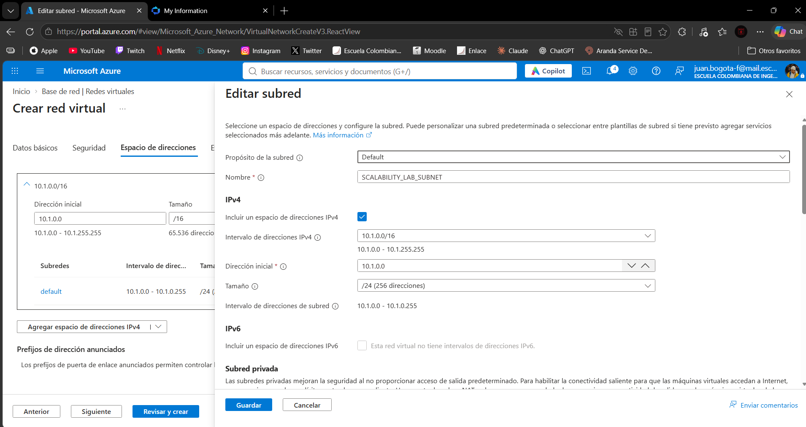

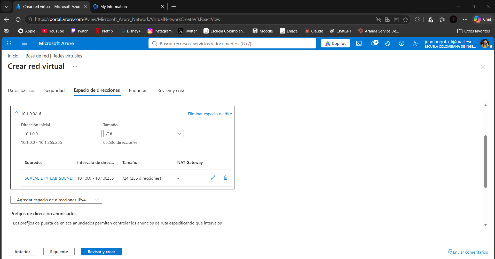

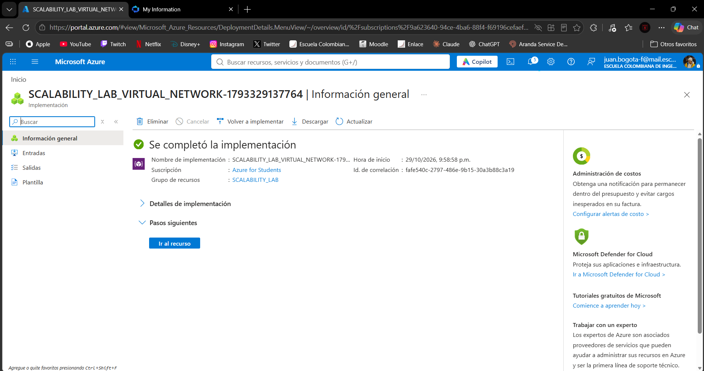


#### Crear las maquinas virtuales (Nodos)

Ahora vamos a crear 3 VMs (VM1, VM2 y VM3) con direcciones IP públicas standar en 3 diferentes zonas de disponibilidad. Después las agregaremos al balanceador de carga.

1. En la configuración básica de la VM guíese por la siguiente imágen. Es importante que se fije en la "Avaiability Zone", donde la VM1 será 1, la VM2 será 2 y la VM3 será 3.


2. En la configuración de networking, verifique que se ha seleccionado la *Virtual Network*  y la *Subnet* creadas anteriormente. Adicionalmente asigne una IP pública y no olvide habilitar la redundancia de zona.


3. Para el Network Security Group seleccione "avanzado" y realice la siguiente configuración. No olvide crear un *Inbound Rule*, en el cual habilite el tráfico por el puerto 3000. Cuando cree la VM2 y la VM3, no necesita volver a crear el *Network Security Group*, sino que puede seleccionar el anteriormente creado.


4. Ahora asignaremos esta VM a nuestro balanceador de carga, para ello siga la configuración de la siguiente imágen.


5. Finalmente debemos instalar la aplicación de Fibonacci en la VM. para ello puede ejecutar el conjunto de los siguientes comandos, cambiando el nombre de la VM por el correcto

```
git clone https://github.com/daprieto1/ARSW_LOAD-BALANCING_AZURE.git

curl -o- https://raw.githubusercontent.com/creationix/nvm/v0.34.0/install.sh | bash
source /home/vm1/.bashrc
nvm install node

cd ARSW_LOAD-BALANCING_AZURE/FibonacciApp
npm install

npm install forever -g
forever start FibonacciApp.js
```

Realice este proceso para las 3 VMs, por ahora lo haremos a mano una por una, sin embargo es importante que usted sepa que existen herramientas para aumatizar este proceso, entre ellas encontramos Azure Resource Manager, OsDisk Images, Terraform con Vagrant y Paker, Puppet, Ansible entre otras.

#### Solución de las maquinas virtuales (Nodos)

Se crearon cuatro máquinas virtuales en Chile Central. VM1 quedó en la zona 1, VM2 en la zona 2, VM3 en la zona 3 y VM4 se creó después, como cuarta máquina para la prueba final. Todas usan Ubuntu Server 24.04 LTS, el usuario azureuser y la misma clave SSH, que se generó al crear VM1 con el nombre VM1_key y se reutilizó en las demás.

Tamaño de las máquinas. El tamaño es Standard DS1_v2, con 1 vCPU y 3,5 GiB de memoria, que cuesta 0,134 USD por hora según el resumen del portal. No es un tamaño barato, pero fue el único de 1 vCPU que la suscripción dejó usar en las 3 zonas de Chile Central. Se necesitaba 1 vCPU porque la suscripción solo permite 6 vCPU por región y la familia DSv2 permite 4, que son justo las 4 máquinas. Con tamaños de 2 vCPU solo habrían cabido 3.

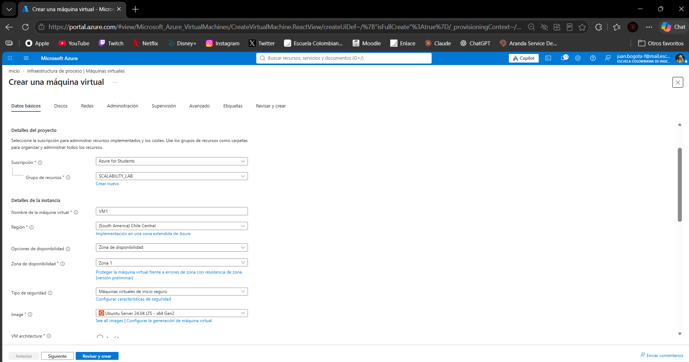

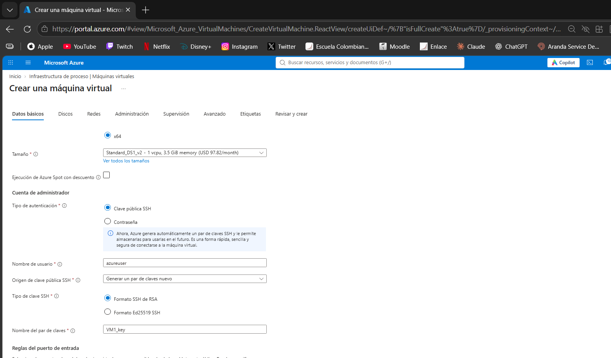

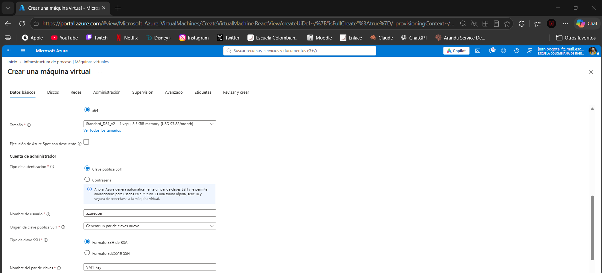

Redes. Cada máquina se conectó a la red virtual SCALABILITY_LAB_VIRTUAL_NETWORK y a la subred SCALABILITY_LAB_SUBNET. Con VM1 se creó el grupo de seguridad de red SCALABILITY_LAB_NETWORK_SECURITY_GROUP, con una regla para SSH por el puerto 22 y otra llamada Port_3000 para el puerto 3000. VM2, VM3 y VM4 usaron ese mismo grupo. Las cuatro se agregaron al Backend Pool del balanceador.

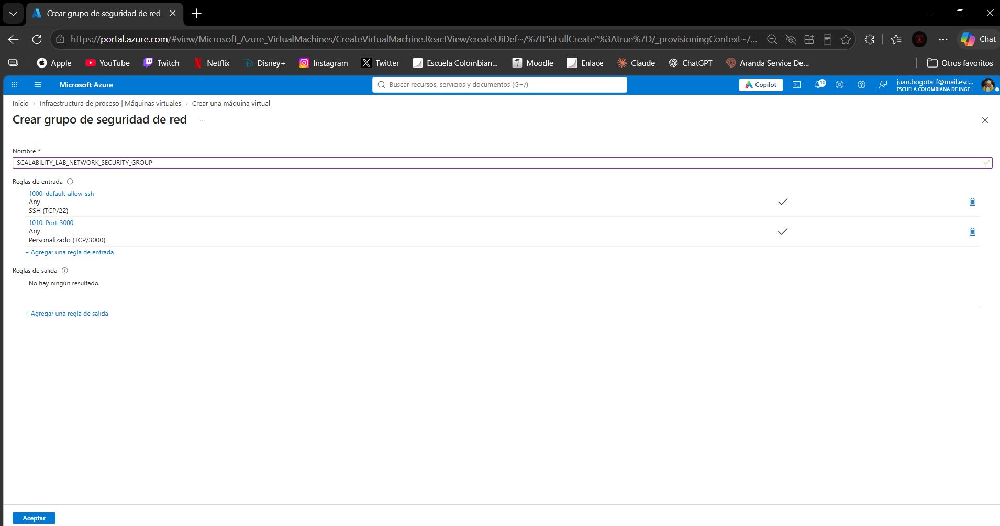

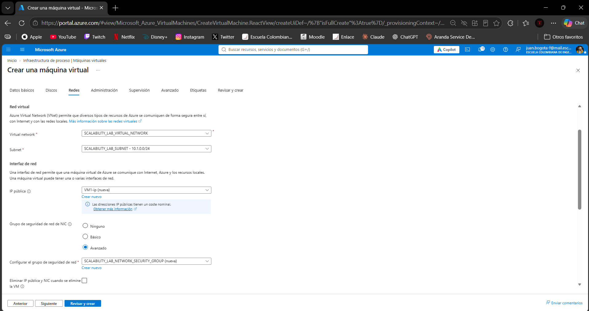

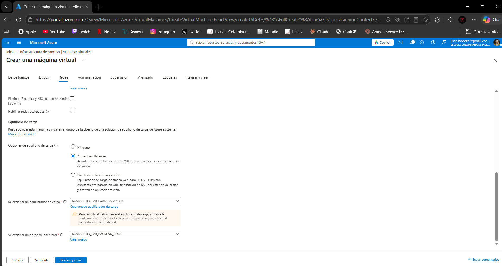

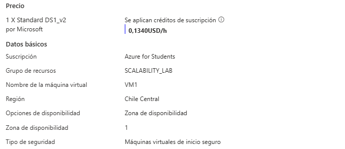

VM2 se creó igual que VM1, cambiando el nombre, la zona a 2 y la clave, que esta vez fue la ya guardada en Azure.

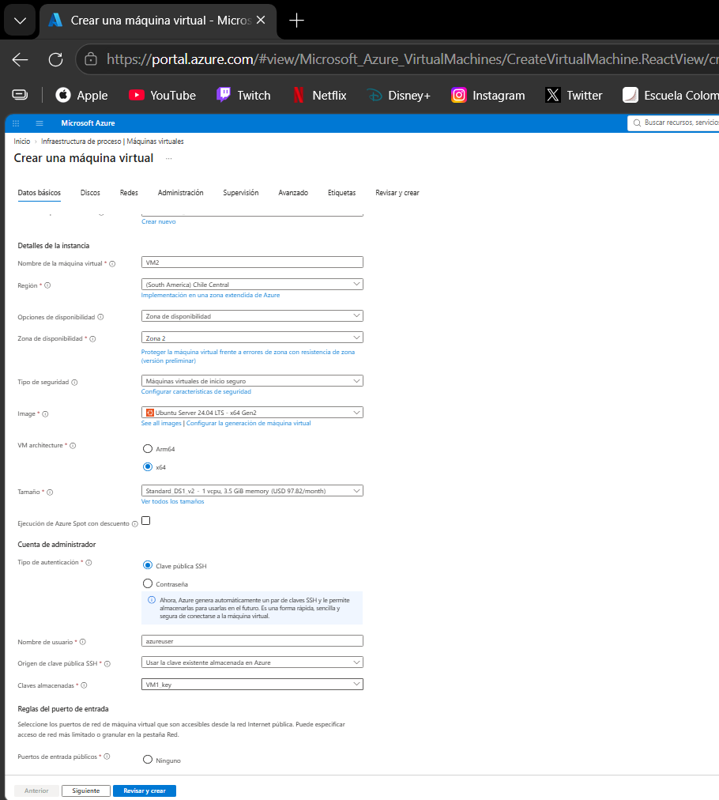

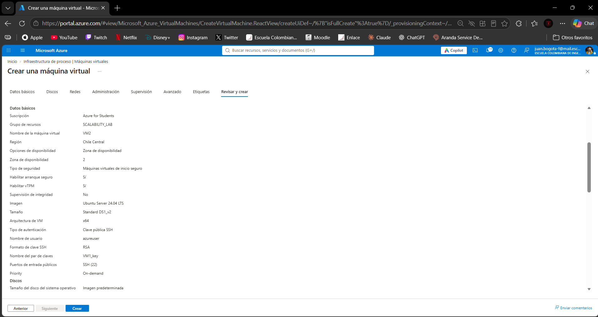

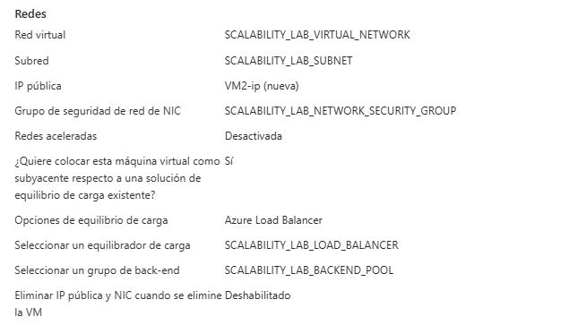

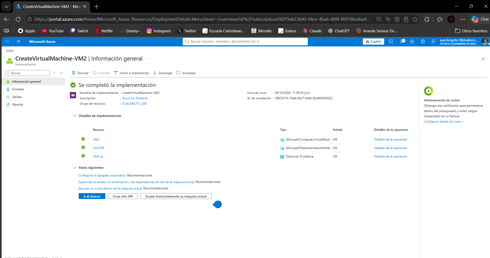

Límite de IPs públicas. VM1 y VM2 se crearon con una IP pública cada una, como pide el enunciado. Al crear VM3 el portal dio error porque la suscripción solo permite 3 direcciones IP públicas y ya estaban usadas por el balanceador, VM1 y VM2.

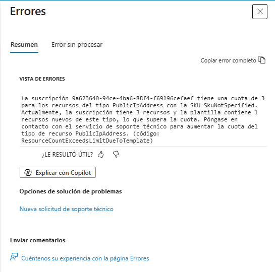

Por eso VM3 se creó sin IP pública.

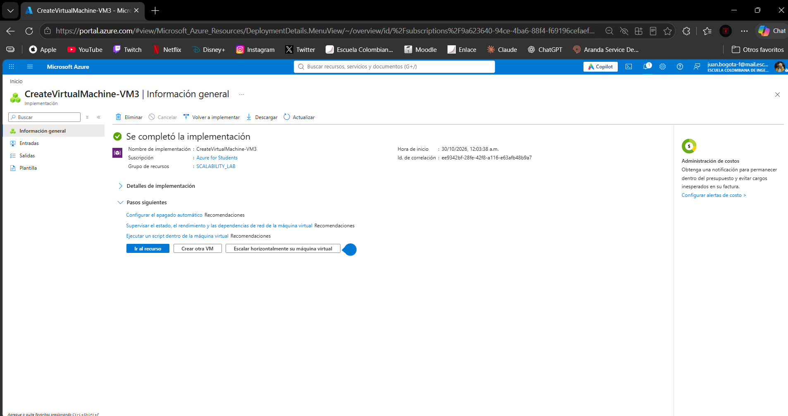

Después se quitó la IP pública de VM1 y de VM2 y se borraron las dos direcciones, para que las cuatro máquinas quedaran iguales y privadas. Así el único punto de entrada es la IP del balanceador, 57.156.38.94, y las máquinas no quedan expuestas directamente a internet.

Regla de salida. Una máquina sin IP pública no tiene salida a internet. Se comprobó en VM3 con una petición a github.com y dio tiempo agotado con código 000. La solución fue crear una regla de salida en el balanceador llamada SCALABILITY_LAB_OUTBOUND_RULE, con la IP LoadBalancerFrontEnd, protocolo todos, inactividad de 4 minutos, restablecimiento de TCP habilitado, el Backend Pool y 1000 puertos de salida por instancia. Al principio el portal mostró el Backend Pool como incompatible porque VM1 y VM2 todavía tenían IP pública. Cuando se las quitó apareció como compatible. En la segunda captura el campo de puertos por instancia aparece en 0 porque se tomó antes de escribir 1000. Con la regla guardada, la misma petición a github.com respondió con código 200.

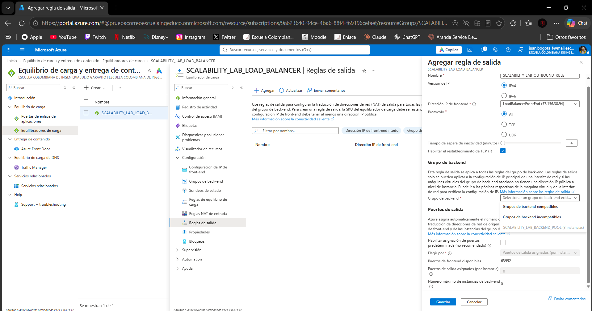


La cuarta máquina, VM4, se creó igual que VM3, sin IP pública.

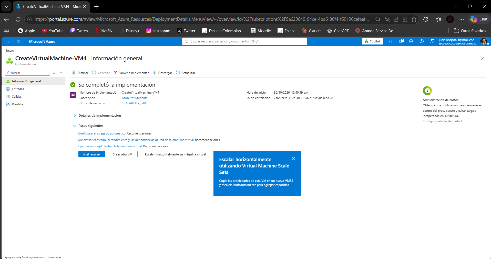

Instalación de la aplicación. Como las máquinas no tienen IP pública no se usó SSH. La aplicación se instaló desde Azure Cloud Shell con la ejecución remota de comandos de Azure, que corre un script dentro de la máquina. El script está en la carpeta scripts, archivo instalar.sh. Instala Node.js, npm y git, clona el repositorio del enunciado, ejecuta npm install y deja la aplicación como un servicio del sistema llamado fibonacci. Se usó un servicio y no forever porque arranca solo si la máquina se reinicia y no depende de ninguna sesión.

Después de instalar se consultó en cada máquina la respuesta de fibonacci 6 y el nombre del servidor. En VM2 y VM3 también se comprobó que el servicio estuviera activo.

| Máquina | Respuesta de fibonacci 6 | Servidor |
|---|---|---|
| VM1 | The answer is 8 | VM1 |
| VM2 | The answer is 8 | VM2 |
| VM3 | The answer is 8 | VM3 |
| VM4 | The answer is 8 | VM4 |

#### Probar el resultado final de nuestra infraestructura

1. Porsupuesto el endpoint de acceso a nuestro sistema será la IP pública del balanceador de carga, primero verifiquemos que los servicios básicos están funcionando, consuma los siguientes recursos:

```
http://52.155.223.248/
http://52.155.223.248/fibonacci/1
```

2. Realice las pruebas de carga con `newman` que se realizaron en la parte 1 y haga un informe comparativo donde contraste: tiempos de respuesta, cantidad de peticiones respondidas con éxito, costos de las 2 infraestrucruras, es decir, la que desarrollamos con balanceo de carga horizontal y la que se hizo con una maquina virtual escalada.

3. Agregue una 4 maquina virtual y realice las pruebas de newman, pero esta vez no lance 2 peticiones en paralelo, sino que incrementelo a 4. Haga un informe donde presente el comportamiento de la CPU de las 4 VM y explique porque la tasa de éxito de las peticiones aumento con este estilo de escalabilidad.

```
newman run ARSW_LOAD-BALANCING_AZURE.postman_collection.json -e [ARSW_LOAD-BALANCING_AZURE].postman_environment.json -n 10 &
newman run ARSW_LOAD-BALANCING_AZURE.postman_collection.json -e [ARSW_LOAD-BALANCING_AZURE].postman_environment.json -n 10 &
newman run ARSW_LOAD-BALANCING_AZURE.postman_collection.json -e [ARSW_LOAD-BALANCING_AZURE].postman_environment.json -n 10 &
newman run ARSW_LOAD-BALANCING_AZURE.postman_collection.json -e [ARSW_LOAD-BALANCING_AZURE].postman_environment.json -n 10
```

#### Solución de las pruebas del resultado final

Todas las pruebas se hicieron desde Azure Cloud Shell, que es una máquina distinta a las del balanceador, contra la IP pública del balanceador, 57.156.38.94.

Prueba de reparto. La respuesta de la aplicación no dice qué máquina la atendió, así que para ver si el balanceador reparte se mandaron peticiones seguidas y se contó cuántas registró cada máquina, leyendo el registro del servicio fibonacci de cada una antes y después.

Con 3 máquinas se mandaron 30 peticiones.

| Máquina | Peticiones recibidas |
|---|---|
| VM1 | 13 |
| VM2 | 7 |
| VM3 | 10 |

Con 4 máquinas se mandaron 40 peticiones.

| Máquina | Peticiones recibidas |
|---|---|
| VM1 | 11 |
| VM2 | 8 |
| VM3 | 15 |
| VM4 | 6 |

Las sumas dan 30 y 40, así que no se perdió ninguna petición y todas las máquinas recibieron tráfico. El reparto no es igual porque Azure no reparte por turnos, decide con un cálculo hecho con los datos de cada conexión.

Punto 2, informe de newman 1. Se usó la colección de la carpeta part2, la petición GET fibonacci con n igual a 1000000, 10 iteraciones por ejecución y dos ejecuciones en paralelo, con 3 máquinas (VM1, VM2 y VM3).

| Ejecución | Peticiones | Fallidas | Duración total | Tiempo medio | Mínimo y máximo |
|---|---|---|---|---|---|
| 1 | 10 | 1 | 1 min 36,2 s | 10,4 s | 8 s y 15,8 s |
| 2 | 10 | 1 | 1 min 36,2 s | 10,2 s | 8,1 s y 15,7 s |

De las 20 peticiones, 18 respondieron bien y 2 terminaron con el error read ECONNRESET, que significa que la conexión se cerró antes de recibir la respuesta. Para saber si se había caído la aplicación se consultó el contador de reinicios del servicio en las tres máquinas y dio 0, así que ninguna se reinició.

Comparación con el escalamiento vertical de la Parte 1, con los datos de Kaliche. Con dos ejecuciones en paralelo:

| Infraestructura | Duración total | Tiempo medio por petición | Fallos | Costo mensual |
|---|---|---|---|---|
| 1 máquina D2as_v4 | 2 min 4 s y 2 min 14 s | 12,3 s y 13,3 s | 0 de 20 | USD 111,69 |
| 1 máquina D4s_v4 | 2 min 51 s y 2 min 42 s | 17,0 s y 16,1 s | 0 de 20 | USD 223,38 |
| 3 máquinas DS1_v2 con balanceador | 1 min 36 s en las dos | 10,4 s y 10,2 s | 2 de 20 | USD 293,46 más balanceador e IP |

Las 3 máquinas terminaron más rápido que la máquina grande, pero con 2 peticiones perdidas, mientras que las máquinas verticales no tuvieron ningún fallo. En costos, las 3 máquinas cuestan más al mes (3 por USD 97,82) porque el tamaño B1ls del enunciado no estuvo disponible y DS1_v2 es mucho más caro. Con el balanceador y su IP pública el costo sube un poco más, y esos dos no se midieron.

Punto 3, cuarta máquina y cuatro ejecuciones en paralelo. Se agregó VM4 y se lanzaron 4 ejecuciones de newman al mismo tiempo. Se hicieron dos tandas.

Primera tanda, entre las 05:51 y las 05:53 UTC (00:51 a 00:53 hora de Colombia).

| Ejecución | Peticiones | Fallidas | Duración total | Tiempo medio | Mínimo y máximo |
|---|---|---|---|---|---|
| 1 | 10 | 1 | 1 min 41,8 s | 11,7 s | 7,7 s y 23,3 s |
| 2 | 10 | 2 | 1 min 19,5 s | 8,0 s | 7,7 s y 8,3 s |
| 3 | 10 | 1 | 1 min 34,2 s | 10,9 s | 7,8 s y 23,3 s |
| 4 | 10 | 0 | 1 min 37,1 s | 9,6 s | 7,7 s y 23,2 s |

En total fueron 40 peticiones, 36 buenas y 4 fallidas.

Segunda tanda, unos minutos después. La ejecución 4 terminó con sus 10 peticiones buenas, en 1 min 18,7 s y con un tiempo medio de 7,8 s (mínimo 7,7 s y máximo 8 s). Las otras tres ejecuciones también terminaron sin errores, porque el sistema las marcó como terminadas con éxito, pero no se guardó su resumen.

Comparación con la máquina vertical grande con 4 ejecuciones en paralelo, con los datos de Kaliche.

| Infraestructura | Duración total | Tiempo medio por petición | Fallos |
|---|---|---|---|
| 1 máquina D4s_v4 | de 4 min 57 s a 5 min 44 s | de 29,6 s a 34,3 s | 0 de 40 |
| 4 máquinas DS1_v2 con balanceador, primera tanda | de 1 min 19 s a 1 min 42 s | de 8,0 s a 11,7 s | 4 de 40 |
| 4 máquinas DS1_v2 con balanceador, segunda tanda | 1 min 18,7 s en la ejecución 4 | 7,8 s en la ejecución 4 | 0 en las 4 ejecuciones |

Con 4 máquinas se atendieron las 40 peticiones en unos 106 segundos, contra 5 min 44 s de la máquina vertical, o sea unas 3 veces más rápido. Si se divide el costo por hora entre las peticiones atendidas por hora, el costo por petición baja de unos 0,0007 USD en la máquina vertical grande a unos 0,0004 USD con las 4 máquinas, siempre que estén ocupadas.

Comportamiento de la CPU de las 4 máquinas. No se guardó la gráfica de CPU de Azure Monitor de estas pruebas, así que aquí no hay valores de CPU medidos y no se inventan. Lo que sí se vio en los tiempos es consistente con lo que dice la Parte 1. Cada máquina tiene 1 vCPU y la aplicación usa un solo hilo, así que una sola petición deja el procesador de esa máquina ocupado al 100 por ciento durante unos 8 segundos. Cuando el balanceador manda dos peticiones a la misma máquina, cada una tarda unos 16 segundos, y cuando manda tres tardan unos 23 segundos, que es lo que se ve en los máximos de la primera tanda. Cuando cada máquina recibió una sola petición, como en la segunda tanda, todas tardaron cerca de 8 segundos.

Por qué la tasa de éxito. El enunciado dice que la tasa de éxito aumentó con este estilo de escalabilidad, pero en nuestros datos no fue así. Con 3 máquinas fue de 90 por ciento (18 de 20), con 4 máquinas en la primera tanda también fue de 90 por ciento (36 de 40), y en la segunda tanda no hubo fallos. La máquina vertical de la Parte 1 tampoco tuvo fallos, porque newman espera sin límite de tiempo y el servidor solo pone las peticiones en fila. Lo que sí mejoró con las máquinas en paralelo fue la velocidad y que el sistema ya no depende de una sola máquina ni de una sola zona. La causa de los errores de conexión no se encontró. Se descartó que la aplicación se reiniciara, pero no se midió si el sondeo de estado marcó alguna máquina ocupada como caída ni si fue la red entre Cloud Shell y el balanceador, así que eso queda como posibilidad sin comprobar.

Evaluación del escenario de calidad. El escenario pide que todas las peticiones sean respondidas con la CPU en 70 por ciento o menos. Con el balanceador las peticiones se responden en mucho menos tiempo que con una sola máquina, pero hubo fallos de conexión en dos de las tres tandas, y como no se midió la CPU no se puede comprobar el 70 por ciento. Se puede decir que la escalabilidad horizontal mejora claramente el tiempo de respuesta y la disponibilidad, porque hay máquinas en tres zonas, pero con estos datos no se puede afirmar que el escenario se cumple por completo.

**Preguntas**

* ¿Cuáles son los tipos de balanceadores de carga en Azure y en qué se diferencian?, ¿Qué es SKU, qué tipos hay y en qué se diferencian?, ¿Por qué el balanceador de carga necesita una IP pública?
* ¿Cuál es el propósito del *Backend Pool*?
* ¿Cuál es el propósito del *Health Probe*?
* ¿Cuál es el propósito de la *Load Balancing Rule*? ¿Qué tipos de sesión persistente existen, por qué esto es importante y cómo puede afectar la escalabilidad del sistema?.
* ¿Qué es una *Virtual Network*? ¿Qué es una *Subnet*? ¿Para qué sirven los *address space* y *address range*?
* ¿Qué son las *Availability Zone* y por qué seleccionamos 3 diferentes zonas?. ¿Qué significa que una IP sea *zone-redundant*?
* ¿Cuál es el propósito del *Network Security Group*?
* Informe de newman 1 (Punto 2)
* Presente el Diagrama de Despliegue de la solución.

#### Respuestas

Tipos de balanceadores de carga en Azure. Azure Load Balancer trabaja en la capa 4, es decir con TCP y UDP, y reparte conexiones sin mirar el contenido. Puede ser público, con una IP de internet, o interno, con una IP privada. Application Gateway trabaja en la capa 7 con tráfico web, y puede enrutar según la dirección URL, manejar certificados SSL y tener firewall de aplicaciones web. Front Door es un balanceador web global que reparte entre regiones. Traffic Manager reparte usando DNS, es decir que decide a qué dirección apunta un nombre. En este laboratorio se usó Azure Load Balancer público.

SKU. El SKU es el nivel o versión de un recurso, y define sus capacidades y su precio. En el balanceador hay Basic, Standard y Puerta de enlace. Standard maneja zonas de disponibilidad, tiene un acuerdo de disponibilidad, soporta muchas más máquinas y es cerrado por defecto, es decir que no deja pasar tráfico hasta que un grupo de seguridad de red lo permite. Basic es más limitado, no maneja zonas y es abierto por defecto. En el portal que se usó solo aparecían Estándar y Puerta de enlace, que sirve para balancear aparatos de red. Se eligió Estándar, que además es el que permite una IP con redundancia de zona.

Por qué el balanceador necesita una IP pública. Un balanceador público es la puerta de entrada desde internet. Los clientes necesitan una dirección a la cual conectarse, y esa es la IP pública del balanceador. Detrás de ella las máquinas usan direcciones privadas. Si no tuviera IP pública, solo sería accesible desde dentro de la red virtual, que es lo que hace un balanceador interno.

Propósito del Backend Pool. Es la lista de máquinas, o más exactamente de sus tarjetas de red, que reciben el tráfico del balanceador. Agregar una máquina al pool es lo que hace que empiece a recibir peticiones, y sacarla hace que deje de recibirlas. Por eso se puede escalar sin cambiar nada del lado de los clientes.

Propósito del Health Probe. Es la prueba que hace el balanceador para saber si cada máquina está sana. Aquí intenta conectarse al puerto 3000 cada 5 segundos. Si una máquina no responde, el balanceador deja de mandarle peticiones hasta que vuelva a responder. Así se evita enviar clientes a una máquina caída.

Propósito de la Load Balancing Rule. Dice qué tráfico recibe el balanceador, a dónde lo manda y cómo. En este caso, lo que llega al puerto 80 de la IP pública va al puerto 3000 de las máquinas del pool, comprobando la salud con el sondeo. También define la persistencia de sesión.

Tipos de sesión persistente. Hay tres. Ninguna reparte cada conexión usando cinco datos, que son la IP y el puerto de origen, la IP y el puerto de destino y el protocolo. IP de cliente manda al mismo cliente siempre a la misma máquina usando solo su IP. IP de cliente y protocolo hace lo mismo usando la IP y el protocolo. Esto importa cuando la aplicación guarda datos del usuario en la memoria de una máquina, porque si la siguiente petición cae en otra, esos datos no están. Pero afecta la escalabilidad, porque un cliente muy activo queda pegado a una sola máquina y la carga se reparte peor. La aplicación de Fibonacci no guarda nada entre peticiones, así que se dejó en ninguna.

Virtual Network, Subnet y los rangos. Una Virtual Network es una red privada propia dentro de Azure, donde viven las máquinas y se comunican entre sí. Una Subnet es una parte de esa red, y sirve para ordenar y separar recursos. El address space es el bloque grande de direcciones de toda la red, aquí 10.1.0.0/16, que tiene 65.536 direcciones. El address range de la subred es la porción de ese bloque que se le da a esa subred, aquí 10.1.0.0/24, con 256 direcciones, y debe quedar dentro del espacio de la red. Azure se reserva 5 direcciones de cada subred.

Availability Zone. Son centros de datos separados dentro de una misma región, cada uno con su propia energía, refrigeración y red. Se pusieron las máquinas en 3 zonas distintas para que, si falla una zona completa, las otras sigan atendiendo. Una IP con redundancia de zona es una IP que no depende de una sola zona y sigue funcionando aunque una falle. La IP del balanceador se consultó con la línea de comandos y apareció en las zonas 1, 3 y 2.

Propósito del Network Security Group. Es el firewall de la red de Azure. Tiene reglas de entrada y de salida, cada una con una prioridad, un puerto, un protocolo y una acción de permitir o denegar. Por defecto bloquea el tráfico de entrada que no se permita. En el laboratorio se abrió el puerto 22 para SSH y el puerto 3000, que es donde escucha la aplicación, y sin esa segunda regla las peticiones del balanceador no habrían llegado a las máquinas.

Informe de newman 1. Está en la sección de pruebas, en el punto 2, con las tablas de las ejecuciones y la comparación con el escalamiento vertical.

Diagrama de despliegue. Muestra al cliente que llama a la IP pública del balanceador, el balanceador con su regla, su sondeo y su regla de salida, y las cuatro máquinas dentro de la red virtual, con el grupo de seguridad de red que permite los puertos 22 y 3000. Las máquinas salen a internet por la IP del balanceador.

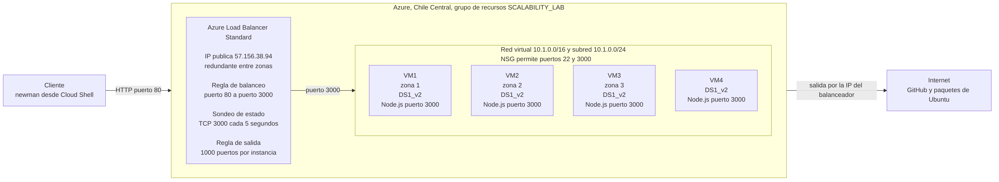
